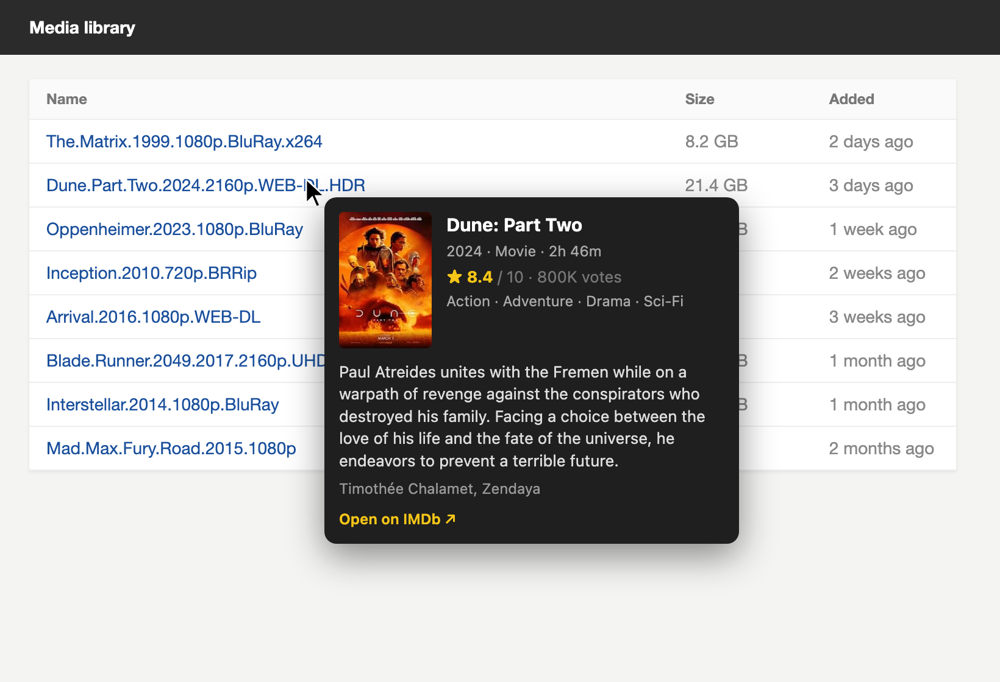

<p align="center"></p>

<h1 align="center">MoviePeek</h1>

<p align="center">A Safari extension that shows a movie's rating, genre and plot when you hover its name.</p>

<p align="center"></p>

## What it's for

Many sites list movies and shows by their file or release name, like `Dune.Part.Two.2024.2160p.WEB-DL`. The name doesn't tell you whether the movie is any good. MoviePeek lets you check without opening a new tab and searching.

## What it does

- **Hover a title link** and a small window opens next to the cursor almost immediately.
- The window shows the **poster, title, year, type, runtime, rating (with vote count), genres, plot and main cast**, plus a link to the title's IMDb page.
- It cleans up release names before searching: `The.Matrix.1999.1080p.BluRay.x264` becomes **The Matrix (1999)**. Quality tags, group names and episode numbers are stripped, and the year is used to pick the right match.
- **You can move the cursor onto the window** and scroll it. It closes once the cursor leaves both the link and the window, or when you press Esc.
- **It only runs on sites you switch on.** Click the MoviePeek button in Safari's toolbar and tick *Enable on this site*.
- Results are cached, so hovering a title again is instant.

## Install

**You need:** a Mac with Safari 17 or newer.

### Option 1: Download (easiest)

1. Download **`MoviePeek-1.4.dmg`** from the [latest release](https://github.com/23mystiq/MoviePeek/releases/latest), open it and drag **MoviePeek** into **Applications**.
2. **Open MoviePeek once.** The app isn't signed by a registered Apple developer, so macOS blocks it the first time:
   - Double-click MoviePeek in Applications and click **Done** on the warning.
   - Go to **System Settings → Privacy & Security**, scroll down, and click **Open Anyway** next to MoviePeek. Confirm with your password.
   - *Or, in Terminal:* `xattr -dr com.apple.quarantine /Applications/MoviePeek.app`, then open it normally.
3. **Allow unsigned extensions in Safari:** Safari → Settings → **Advanced** → tick *Show features for web developers*. Then in the new **Developer** tab, tick **Allow unsigned extensions**.
4. **Turn it on:** Safari → Settings → **Extensions** → tick **MoviePeek**.
5. **Enable it on a site:** open the site, click the MoviePeek toolbar button and tick **Enable on this site**. When Safari asks for permission, allow it.

> **Safari forgets "Allow unsigned extensions" every time it quits.** After restarting Safari, tick it again (step 3) and MoviePeek comes back. This is how Safari treats any extension that isn't from the App Store or signed by a registered developer. If that gets annoying, build it yourself (Option 2) with an Apple Developer account and Safari keeps it enabled.

### Option 2: Build it yourself

This takes about two minutes and needs [Xcode](https://apps.apple.com/app/xcode/id497799835) (free).

1. **Get the code**
   ```sh
   git clone https://github.com/23mystiq/MoviePeek.git
   ```
2. **Open the project:** double-click `MoviePeek/MoviePeek.xcodeproj`.
3. **Set up signing:** in Xcode, select the **MoviePeek** project → **Signing & Capabilities**, and choose your Apple ID under **Team** for both the *MoviePeek* and *MoviePeek Extension* targets. A free Apple ID works (Xcode → Settings → Accounts to add one).
4. **Pick a unique bundle ID:** select the **MoviePeek** project (not a target) → **Build Settings**, search for `BUNDLE_ID_PREFIX` and change `org.moviepeek` to something of your own, e.g. `com.yourname`.
5. **Run it:** press **⌘R**. A small MoviePeek window opens. You can close it after the next step.
6. **Turn it on in Safari:** Safari → Settings → **Extensions** → tick **MoviePeek**.
   - If it isn't listed, go to Safari → Settings → **Advanced**, tick *Show features for web developers*, then in the **Developer** tab tick *Allow unsigned extensions*.
7. **Enable it on a site:** open the site, click the MoviePeek toolbar button and tick **Enable on this site**. When Safari asks for permission, allow it.

To keep MoviePeek around, copy `MoviePeek.app` to your Applications folder. In Xcode: Product → Show Build Folder in Finder → `Products/Debug`.

> With a free Apple ID, apps you build yourself stop launching after about 7 days. Just press ⌘R in Xcode again to rebuild.

#### Build from the command line

```sh
cd MoviePeek
xcodebuild -scheme MoviePeek -configuration Release -derivedDataPath build \
  DEVELOPMENT_TEAM=<your team ID> BUNDLE_ID_PREFIX=com.yourname -allowProvisioningUpdates
cp -R build/Build/Products/Release/MoviePeek.app ~/Applications/
open ~/Applications/MoviePeek.app
```

## How it works

| Part | What it does |
| --- | --- |
| [`extension/content.js`](extension/content.js) | Detects hovered title links, parses the name, and draws the pop-up (inside a shadow DOM, so page styles can't break it). |
| [`extension/background.js`](extension/background.js) | Looks up the title and its details and caches the results. |
| [`MoviePeek/MoviePeek Extension/SafariWebExtensionHandler.swift`](MoviePeek/MoviePeek%20Extension/SafariWebExtensionHandler.swift) | Makes the actual web requests from the native side. IMDb's endpoints don't allow browser cross-origin requests, so the app fetches the data and passes it to the extension. It only contacts the two IMDb hosts below. |
| [`extension/popup.html`](extension/popup.html) | The toolbar popup for switching sites on and off. |

Title search uses IMDb's public suggestion endpoint (`v3.sg.media-imdb.com`). Rating, genres, runtime and plot come from IMDb's GraphQL endpoint (`caching.graphql.imdb.com`).

To change the extension, edit the files in `extension/` and rebuild in Xcode. The Xcode project reads them from that folder directly.

## Privacy

- MoviePeek does nothing on a site until you enable that site.
- The only data it sends anywhere is the title you hover, sent to IMDb to look it up.
- No analytics or tracking. The list of sites you enabled is stored locally in Safari.

## Disclaimer

MoviePeek is an independent hobby project. It isn't affiliated with, endorsed by or connected to IMDb or Amazon. It uses IMDb's public but unofficial endpoints, which IMDb provides for personal, non-commercial use and may change or block at any time. Movie data and posters belong to their respective owners. MoviePeek only displays information; it doesn't download, host or link to any media.

## License

[MIT](LICENSE)
